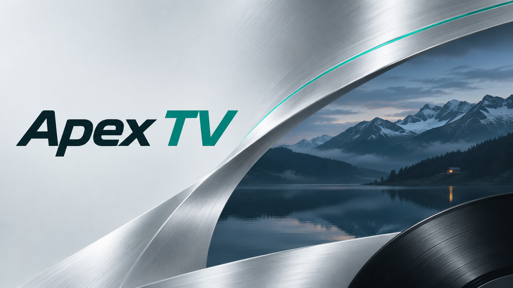

<a id="top"></a>

<p align="center">
  
</p>

<h1 align="center">Apex TV</h1>

<p align="center">
  
  &nbsp;
  <a href="README.md"></a>
</p>

<p align="center">
  <a href="src/lib/version.ts"></a>
  <a href="https://nextjs.org/"></a>
  <a href="https://react.dev/"></a>
  <a href="https://www.typescriptlang.org/"></a>
  <a href="https://vercel.com/"></a>
  <a href="LICENSE"></a>
</p>

<p align="center">
  <a href="#features">Features</a> &nbsp;·&nbsp; <a href="#interface">Interface &amp; devices</a> &nbsp;·&nbsp; <a href="#deploy">Deployment</a> &nbsp;·&nbsp; <a href="#services">Services</a>
  <br>
  <a href="#development">Development</a> &nbsp;·&nbsp; <a href="#scope">Scope of use</a> &nbsp;·&nbsp; <a href="#license">License &amp; credits</a>
</p>

---

Apex TV is a self-hosted media aggregation player based on [MoonTVPlus](https://github.com/mtvpls/MoonTVPlus). It brings video, private libraries, live streams, music, and reading into one interface, with favorites, personal lists, and viewing plans to organize your collection.

The project primarily targets Vercel deployment. Its silver, graphite, and teal interface adapts to desktops, phones, tablets, and browser-based TV screens.

> [!IMPORTANT]
> This repository does not include media, third-party accounts, or access credentials. Configure sources and services you are authorized to use after deployment.

<a id="features"></a>

## 🎬 Main features

| Module | Description |
| --- | --- |
| Video and short dramas | Aggregated search, categories, episode and source selection, and dedicated short-drama browsing and playback |
| Browser player | Speed controls, progress tracking, danmaku, external subtitles, video upscaling, and external player links |
| Personal collection | Favorites, recent history, custom lists, and viewing plans: watch later, watching, completed, or on hold |
| Private library | Browse, search, and play your media through OpenList, Emby, or Xiaoya |
| TV channels | M3U channel lists, categories, favorites, and program guides |
| Live platforms | Platform rooms and custom streams, with available creator details, quality options, and playback routes |
| Music | Search, charts, playlists, lyrics, a playback queue, and floating playback controls |
| E-books | OPDS and compatible Legado sources, with search, chapters, reading, shelves, history, and read-aloud controls |
| Manga | Recommendations, search, details, chapter reading, shelves, and reading history |
| AI and watch rooms | An AI media assistant, shared viewing, music synchronization, and screen sharing through configured services |
| Administration | Users, permissions, content sources, appearance, connected services, and notifications |

Entries depend on site settings and account permissions. Persistent storage makes account data such as favorites and playback history available across devices. Preferences and reading settings follow the storage scope of each feature.

<a id="interface"></a>

## 🎨 Interface and devices

The home page focuses on recommendations and continue watching; search has its own page. Desktop layouts use side or top navigation to suit browsing and playback. Phones use bottom navigation, while tablets adapt lists, panels, and players to the available width. Web TV provides large-screen pages and remote-control navigation.

The main interface starts in light mode, with a manual dark-mode switch. Both themes share teal accents; the reader keeps its own paper colors and typography settings. Supported browsers use a full-page theme transition and respect reduced-motion preferences.

Codec support, autoplay, picture-in-picture, upscaling, and external player links vary by device and browser. The PWA can be installed, but installation does not download media.

<a id="deploy"></a>

## 🚀 Deploy to Vercel

Prepare a Vercel account and a persistent database, then fork or copy this repository to your GitHub account and import it into Vercel. You can also use the deployment button:

[](https://vercel.com/new/clone?repository-url=https%3A%2F%2Fgithub.com%2FJettHayes%2FApexTV)

Select **Next.js** and **Node.js 24.x**, keeping the default output directory. The package manager version is specified in `package.json`. Use `pnpm install --frozen-lockfile` to install and `pnpm build` to build.

For Upstash Redis, add these under **Settings → Environment Variables**:

| Variable | Description |
| --- | --- |
| `USERNAME` | Site owner account |
| `PASSWORD` | A strong, unique password, also used to sign login credentials |
| `NEXT_PUBLIC_STORAGE_TYPE` | Set to `upstash` |
| `UPSTASH_URL` | Database REST URL |
| `UPSTASH_TOKEN` | Database access token |

After deployment, sign in with the owner account and open the admin panel from the user menu to configure sources and services. Add custom domains under **Settings → Domains** in Vercel. Environment variable changes require a redeployment.

<details>
<summary>🗃️ Storage and deployment limits</summary>

The code retains storage adapters for Redis, Kvrocks, Postgres, Turso, and D1/SQLite. See the [storage implementation](src/lib/db.ts). Check runtime support, connection settings, and database initialization before choosing another backend.

On Vercel, scans and proxies are subject to function duration, instance lifetime, and bandwidth limits. Server-side local downloads are not a persistent download solution. Watch-room synchronization requires an external realtime service; a default Next.js deployment does not start the built-in service in `server.js`.

</details>

<a id="services"></a>

## 🔌 Connected services

| Module | Connection |
| --- | --- |
| Video and short dramas | Add compatible video APIs or import a configuration; short-drama categories require corresponding source content |
| Title metadata | Configure providers such as TMDB or Douban as needed |
| Private library | Connect OpenList, Emby, or Xiaoya in the admin panel |
| TV channels | Import an authorized M3U channel list, optionally with a program guide |
| Live platforms | Adapters for Huya, Bilibili, Douyin, and Douyu; official player embeds for YouTube Live and Twitch; custom live streams |
| Music | Connect a compatible LX music backend and configure authentication |
| E-books | Add OPDS libraries or import Legado JSON subscriptions |
| Manga | Connect a compatible manga service or use configured manga parsing sources |
| AI and notifications | Configure model, email, Telegram, or other notification services as needed |

Metadata and playback URLs come from different services. A poster does not guarantee a playable source. Live quality options, embedded players, and media playback depend on source permissions, network access, and browser support.

Legado compatibility remains experimental and covers only some parsing rules. Sources requiring Android, WebView, or interactive sign-in may not work. Importing a subscription does not guarantee access to chapters, text, or covers.

Most settings are available in the admin panel. See the [configuration code](src/lib/config.ts) and [configuration types](src/lib/admin.types.ts) for environment variables and fields. Source-script interfaces are documented in [SOURCE_SCRIPT.md](SOURCE_SCRIPT.md).

<a id="development"></a>

## 🛠️ Local development

Use a patched **Node.js 24** release and the **pnpm** version specified in `package.json`:

```bash
git clone https://github.com/JettHayes/ApexTV.git
cd ApexTV
pnpm install --frozen-lockfile
```

Create an untracked `.env.local` in the project root with login and development database settings. Run `pnpm dev`, then open `http://localhost:3000`. Use a separate database for development.

| Command | Purpose |
| --- | --- |
| `pnpm dev` | Start the development server |
| `pnpm build` | Build the application |
| `pnpm typecheck` | Check types |
| `pnpm lint` | Run lint checks |
| `pnpm test` | Run tests |
| `pnpm format:check` | Check formatting |

Pages and APIs are in `src/app`, shared components in `src/components`, service and storage logic in `src/lib`, and theme styles in `src/styles`.

An optional [upstream synchronization workflow](.github/workflows/sync_fork.yml) prepares sync PRs for review. Review the differences before merging, and back up important settings and data before updates or database changes.

<a id="scope"></a>

## 📌 Scope of use

The project provides a media search and playback interface. Third-party service names describe compatibility and do not imply an official partnership, authorization, or endorsement.

Use APIs, media, and related assets in accordance with their terms and permissions. The repository license does not grant rights to third-party content or trademarks. Dependencies and assets retain their own licenses.

<a id="license"></a>

## 📄 License and acknowledgments

Original additions and modifications to Apex TV authored by [JettHayes](https://github.com/JettHayes) © 2026 JettHayes. Rights in upstream code and third-party content remain with their respective rights holders.

This project is licensed under **[CC BY-NC-SA 4.0](LICENSE)**.

Thanks to **[MoonTVPlus](https://github.com/mtvpls/MoonTVPlus)** for the original implementation.

<p align="center"><a href="#top">↑ Back to top</a></p>
