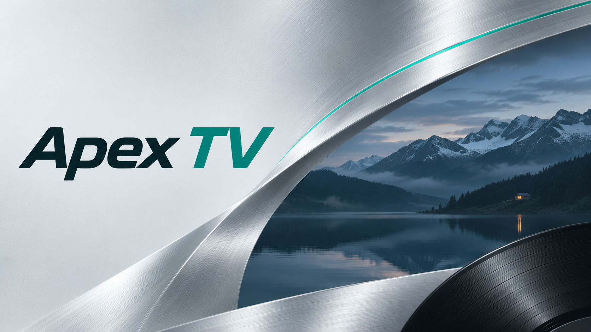

<a id="top"></a>

<p align="center">
  
</p>

<h1 align="center">Apex TV</h1>

<p align="center">
  
  &nbsp;
  <a href="README.md"></a>
</p>

<p align="center">
  <a href="https://nextjs.org/"></a>
  <a href="https://react.dev/"></a>
  <a href="https://www.typescriptlang.org/"></a>
  <a href="https://vercel.com/"></a>
  <a href="LICENSE"></a>
</p>

<p align="center">
  <a href="#features">Features</a> &nbsp;·&nbsp; <a href="#interface">Interface &amp; devices</a> &nbsp;·&nbsp; <a href="#deploy">Deployment</a> &nbsp;·&nbsp; <a href="#services">Services</a>
  <br>
  <a href="#development">Development</a> &nbsp;·&nbsp; <a href="#updates">Updates</a> &nbsp;·&nbsp; <a href="#scope">Scope of use</a> &nbsp;·&nbsp; <a href="#license">License &amp; credits</a>
</p>

---

Apex TV is a self-hosted media aggregation player based on [MoonTVPlus](https://github.com/mtvpls/MoonTVPlus). It brings video search, private libraries, live streams, and music into one interface for your own media services and collections.

This branch is maintained around deployment on Vercel. It customizes the branding, themes, navigation, and parts of the library, live-streaming, and music experience. The silver and teal interface adapts to desktops, phones, and tablets.

> [!IMPORTANT]
> This repository does not include video, live-streaming, or music content, nor does it provide third-party accounts or access credentials. After deployment, configure sources you are authorized to use.

<a id="features"></a>

## 🎬 Main features

| Feature | Description |
| --- | --- |
| Video search | Search configured sources, select episodes, and switch sources |
| Home and history | Featured carousel, poster lists, favorites, and continue watching |
| Browser playback | Common streaming formats, playback speed controls, progress tracking, and external player links |
| Private library | Browse and search collections from OpenList, Emby, or Xiaoya |
| TV channels | Configure M3U channel lists and program guides |
| Live platforms | Configure sources by platform and room, with available room information |
| Music | Connect a compatible backend for search, charts, playlists, lyrics, and a playback queue |
| Administration | Manage users, permissions, media sources, and site appearance |
| Multiple devices | Desktop sidebar, mobile bottom navigation, compact tablet layouts, and PWA installation |

A persistent database makes playback history, favorites, and other data available across devices. Visible entries depend on feature settings and account permissions. Playback support depends on the source, backend service, and browser.

<details>
<summary>🧩 Optional features</summary>

The code also includes on-screen comments (danmaku), external subtitles, WebGPU video upscaling, an AI media assistant, manga and e-book reading, watch rooms, notifications, and browser-based TV pages. Some features require additional services or compatible browsers and devices.

Source scripts are an experimental extension. See [SOURCE_SCRIPT.md](SOURCE_SCRIPT.md) for the interface documentation.

This branch has removed the upstream native Android TV project and some platform deployment files. The browser-based TV pages remain available.

</details>

<a id="interface"></a>

## 🎨 Interface and devices

The home page focuses on featured titles and continue watching, with search on a separate page. Phones use bottom navigation for the main sections. Tablet layouts adjust the sidebar and player according to available width.

The default theme is light. Click the appearance button to switch between light and dark; your choice is remembered. Theme changes use a short transition and respect the system's reduced-motion preference.

Support for video codecs, autoplay, and opening external players varies between browsers. Installing the PWA does not download your media.

<a id="deploy"></a>

## 🚀 Deploy to Vercel

### 1. Prepare and import

You will need a Vercel account and a persistent database. The steps below use the Upstash Redis REST API.

Fork or copy this repository to your GitHub account, import it into Vercel, and select Next.js. You can also use the deployment button:

[](https://vercel.com/new/clone?repository-url=https%3A%2F%2Fgithub.com%2FJettHayes%2FApexTV)

| Project setting | Suggested value |
| --- | --- |
| Framework Preset | Next.js |
| Node.js | 24.x |
| Package manager | pnpm, with the version specified in `package.json` |
| Install Command | `pnpm install --frozen-lockfile` |
| Build Command | `pnpm build` |
| Output Directory | Next.js default |

### 2. Configure environment variables

Add these under **Settings → Environment Variables** in Vercel:

| Variable | Description |
| --- | --- |
| `USERNAME` | Site owner account |
| `PASSWORD` | A strong, unique password; also used to sign login credentials |
| `NEXT_PUBLIC_STORAGE_TYPE` | Set to `upstash` when using Upstash |
| `UPSTASH_URL` | Database REST URL |
| `UPSTASH_TOKEN` | Database access token |

Keep credentials in the deployment environment or admin settings, not in the repository. Redeploy after changing environment variables.

### 3. Sign in and configure

Once deployed, sign in with the owner account and open the admin panel from the user menu or at `/admin`. Configure the sources and services you need. Custom domains can be added under **Settings → Domains** in Vercel.

<details>
<summary>🗃️ Other storage options and deployment limits</summary>

The code retains adapters for Redis, Kvrocks, Postgres, Turso, and D1/SQLite. See [src/lib/db.ts](src/lib/db.ts). Check connection settings and database schemas before selecting another backend. This branch does not include the upstream database initialization scripts.

For Vercel deployments:

- External services must be reachable from the deployment environment. Services on another server or a private network are not connected automatically.
- Proxying audio and video consumes bandwidth and function resources.
- Background work such as library scans is subject to instance lifetimes and function duration limits. Scan progress is not backed by a persistent job queue.
- Server-side local downloads require long-running tasks and storage, so they are not suitable as a persistent download solution on Vercel.
- The built-in realtime service relies on `server.js`, which a default Next.js deployment does not start. Watch rooms and similar features require an external service or additional deployment work.

See the [Vercel documentation](https://vercel.com/docs/functions) for current platform capabilities and quotas.

</details>

<a id="services"></a>

## 🔌 Connected services

The person deploying the app configures each service. Confirm that content is accessible in its original service before connecting it to Apex TV.

| Module | Connection |
| --- | --- |
| Video sources | Add compatible video APIs or import a configuration in the admin panel |
| Title metadata | Configure metadata providers such as TMDB or Douban as needed |
| Private library | Configure OpenList, Emby, or Xiaoya in the admin panel |
| TV channels | Import an M3U channel list you are authorized to use, optionally with a program guide |
| Live platforms | Adapters for Huya, Bilibili, and Douyin are included; availability depends on interface changes and access conditions |
| Music | Configure a compatible LX music backend and its authentication |
| Reading and other extensions | Configure the reading, model, notification, or realtime service required by each feature |

Title metadata and playback URLs come from different services. A poster does not mean a playable source exists, and a listed file may use a codec your browser cannot decode.

Third-party interfaces, permissions, and access rules can change. The project does not guarantee availability for every source, region, or device.

<details>
<summary>⚙️ Common optional environment variables</summary>

Most day-to-day settings are available in the admin panel. Common deployment variables are listed below; see the [configuration code](src/lib/config.ts) and [configuration types](src/lib/admin.types.ts) for details.

| Variable | Purpose |
| --- | --- |
| `NEXT_PUBLIC_SITE_NAME` | Initial site name |
| `NEXT_PUBLIC_SITE_URL` | Public site URL |
| `ANNOUNCEMENT` | Initial announcement |
| `INIT_CONFIG` | Initial JSON configuration |
| `CONFIG_SUBSCRIPTION_URL` | Configuration subscription URL |
| `TMDB_API_KEY` | TMDB API key |
| `MUSIC_V2_BASE_URL`, `MUSIC_V2_TOKEN` | Music backend URL and token |
| `DANMAKU_API_BASE`, `DANMAKU_API_TOKEN` | Danmaku backend settings |
| `WATCH_ROOM_ENABLED`, `WATCH_ROOM_SERVER_TYPE` | Watch room switch and service type |
| `WATCH_ROOM_EXTERNAL_SERVER_URL`, `WATCH_ROOM_EXTERNAL_SERVER_AUTH` | External watch room settings |
| `ENABLE_TV_MODE` | Browser-based TV mode switch |
| `CRON_PASSWORD` | Scheduled-task authentication; must match the scheduler path |

Do not publish actual keys, database connection strings, or subscription URLs containing access tokens.

</details>

<a id="development"></a>

## 🛠️ Local development

Use **Node.js 24** and **pnpm 10.14.0**:

```bash
git clone https://github.com/JettHayes/ApexTV.git
cd ApexTV
pnpm install --frozen-lockfile
```

Create an untracked `.env.local` file in the project root with account and development database settings, then run:

```bash
pnpm dev
```

Open `http://localhost:3000`. Local development connects to the services you configure, so use a separate development database.

| Command | Purpose |
| --- | --- |
| `pnpm dev` | Start the development server |
| `pnpm build` | Build the application |
| `pnpm typecheck` | Check types |
| `pnpm lint` | Run lint checks |
| `pnpm test` | Run tests |
| `pnpm format:check` | Check formatting |

Pages and APIs are in `src/app`, shared components in `src/components`, service and storage logic in `src/lib`, and theme styles in `src/styles`.

<a id="updates"></a>

## 🔄 Updates and maintenance

The [Upstream Sync](.github/workflows/sync_fork.yml) workflow checks for MoonTVPlus updates and prepares a synchronization PR. It requires `SYNC_TOKEN` and the appropriate permissions. It does not merge directly into `main`.

Review differences between upstream and this branch before merging, and use **Create a merge commit** as described in the workflow. Automatic deployment depends on the repository and production branch configured in Vercel.

Back up important settings and data before updating or switching databases.

<a id="scope"></a>

## 📌 Scope of use

This project provides a media search and playback interface. Third-party service names identify compatibility only and do not imply an official partnership, authorization, or endorsement.

Use APIs, media, and related images in accordance with their terms and permissions. The repository license does not grant rights to third-party content or trademarks. Third-party dependencies and assets remain subject to their own licensing terms.

<a id="license"></a>

## 📄 License and acknowledgments

Original additions and modifications to Apex TV authored by [JettHayes](https://github.com/JettHayes) © 2026 JettHayes. Rights in upstream code and third-party content remain with their respective rights holders.

This project is licensed under **[CC BY-NC-SA 4.0](LICENSE)**.

Thanks to **[MoonTVPlus](https://github.com/mtvpls/MoonTVPlus)** for the original implementation.

<p align="center"><a href="#top">↑ Back to top</a></p>
